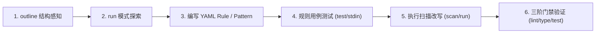

# ast-grep 代码探索与结构化重构规范

本规范固化了在 TypeScript / SQL / Schema 代码库中进行结构探索与代码重构的标准 SOP。

---

## 核心原则与红线禁令 (Core Principles & Red Lines)

1. **语法结构重构与修改唯一指定工具**：所有涉及代码语法、函数签名、中间件、Schema、调用链、导入路径等代码变更，**必须强制使用 `ast-grep`**。
2. **严禁逐个文件手动重复修改 (Strict Ban on File-by-File Manual Edits)**：**严禁使用单文件替换工具（如 `replace_file_content`、`multi_replace_file_content`）逐个文件轮询改写相同模式的代码**。无论是单文件还是多文件，凡涉及模式替换、接口调用迁移、重命名或语法改写，一律禁止逐个文件手工编辑，必须通过 `ast-grep` 批量/精准执行。
3. **严禁正则批量替换代码**：**严禁使用 `sd`、`sed` 或普通正则表达式对代码文件进行批量文本替换**（防止破坏 AST 结构、导致多行嵌套错乱或同名标识符误伤）。`sd` 仅允许在 Markdown、文档注释与非代码配置文件中使用。
4. **分级重构机制**：
   - **轻量/单次改写**：使用 `ast-grep run -p ... -r ...` 单行模式快速改写。
   - **系统级/跨模块改写**：编写 YAML 规则，经测试验证后使用 `ast-grep scan --update-all` 执行。

---

## 4 步强制执行流程 (Mandatory 4-Step Execution Flow)

当接收到代码语法修改、批量修复、接口变更或重构任务时，必须严格执行以下 4 步：

```text
1. [识别模式] → 确认改动属于语法/模式改动（路径迁移、接口调用、签名重构、类型重命名等）
2. [封锁单文件工具] → 坚决禁止调用 replace_file_content 逐个文件串行修改
3. [测试规则] → 编写 YAML rule 或单行 pattern，并在 scratch/rule.yml 或 stdin 验证改写效果
4. [批量应用] → 统一调用 rtk ast-grep scan --update-all 或 ast-grep run --update-all 执行批量精准改写
```

---

## 标准重构 6 步 SOP (Refactoring Workflow)



### 1. 结构感知 (Understand Structure via `outline`)

在不阅读或修改完整文件前，使用 `ast-grep outline` 快速生成模块的大纲视图：

```bash
# 查看单文件顶层导出与函数签名
rtk ast-grep outline src/api/admin/users/service.ts

# 查看目录下所有模块的导出符号
rtk ast-grep outline src/database/schema --items exports

# 查看依赖导入关系
rtk ast-grep outline src/setup --items imports --view signatures

# 展开特定符号的内部成员
rtk ast-grep outline src/lib/hash.ts --match Hash --view expanded
```

### 2. 模式探索 (Pattern Exploration via `run`)

使用 `ast-grep run` 配合模式通配符定位目标代码：

```bash
# 基础模式匹配（$VAR 匹配单节点，$$$ARGS 匹配多参数）
rtk ast-grep run --pattern 'app.openapi($ROUTE, $HANDLER)' --lang ts src/

# 调试模式语法树（检查 AST 解析是否符合预期）
rtk ast-grep run --pattern 'app.openapi($$$ARGS)' --lang ts --debug-query=pattern
```

### 3. 创建重构规则 (Create Rules)

- **单次改动**：直接进入步骤 5 使用 `ast-grep run -p ... -r ...`。
- **系统级改动**：在临时目录（如 `scratch/rule.yml`）或规则目录创建 YAML 规则：

```yaml
id: migrate-deprecated-auth
language: typescript
rule:
  pattern: c.get('jwtPayload')
fix: getAuthUser(c)
```

若涉及关系型嵌套匹配（`inside` / `has`），**务必显式指定 `stopBy: end`**：

```yaml
id: find-unhandled-service-call
language: typescript
rule:
  pattern: UserService.$METHOD($$$ARGS)
  inside:
    kind: arrow_function
    stopBy: end
```

### 4. 验证规则 (Validate Rules via Test / Stdin)

在批量应用前，通过标准输入或测试用例验证改写正确性：

```bash
# 通过 stdin 快速验证单条规则改写
echo "const user = c.get('jwtPayload');" | rtk ast-grep scan --inline-rules "id: test
language: typescript
rule:
  pattern: c.get('jwtPayload')
fix: getAuthUser(c)" --stdin
```

### 5. 批量应用改写 (Apply Changes)

```bash
# 方式 A：基于 YAML 规则批量应用
rtk ast-grep scan --rule scratch/migrate-rule.yml --update-all src/

# 方式 B：基于 run 单行命令直接改写
rtk ast-grep run --pattern 'c.get("jwtPayload")' --rewrite 'getAuthUser(c)' --lang ts --update-all src/
```

### 6. 后置三阶门禁验证 (Post-Rewrite Verification Gate)

重构完成后，**必须按顺序执行以下命令**，确保代码格式合规、TypeScript 类型零报错、集成测试全部通过：

```bash
# 1. 自动格式化与代码风格修复
rtk bun run lint

# 2. TypeScript 严格类型检查（杜绝重构破坏函数签名或导出类型）
rtk bun run type

# 3. 运行完整自动化测试套件
rtk bun run test

# 4. 执行项目全局终极门禁
rtk just check
```

---

## 常用通配符与参数速查

| 语法 / 参数 | 用途说明 | 示例 |
| :--- | :--- | :--- |
| `$VAR` | 匹配单个 AST 节点（标识符、表达式、类型） | `response.success(c, $DATA)` |
| `$$$ARGS` | 匹配 0 个或多个 AST 节点序列 | `app.openapi($$$ARGS)` |
| `$$$PARAM` | 匹配函数入参列表 | `function ($$$PARAM) { $$$BODY }` |
| `--update-all` | 直接应用改写到文件系统（无需交互确认） | `ast-grep scan --rule r.yml --update-all` |
| `--debug-query=cst` | 打印目标代码的完整语法树（含标点符号） | 用于定位 `kind` 名称 |
| `stopBy: end` | 关系型匹配下深度遍历整个子树 | 在 `inside` / `has` 规则中必须添加 |
